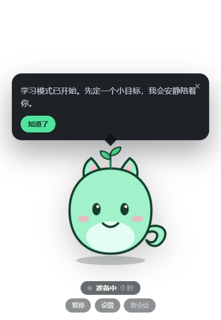
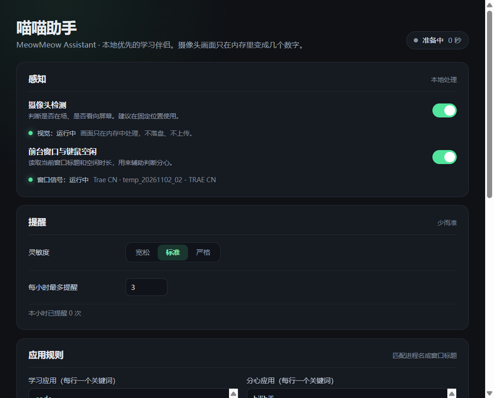

# 喵喵助手 · MeowMeow Assistant

一个本地优先的桌面学习伴侣：透明桌宠常驻桌面，用摄像头、前台窗口和键鼠空闲判断你是否在学习；走神时用气泡提醒，而不是弹窗打断。

当前是 **M1（桌宠 + 学习感知）** 的可运行版本：不接大模型也能用，Live2D 模型可选，内置形象作为兜底。





## 当前能做什么

- 透明、无边框、置顶、鼠标穿透的桌面窗口；悬停到桌宠或气泡时才接收点击。
- 托盘菜单：显示/隐藏、暂停检测、开始新会话、设置、退出。
- 摄像头本地推理：MediaPipe Face Landmarker 判断是否在场、是否看向屏幕。
- 前台窗口 + 键鼠空闲：访问学习应用时是正向信号，命中分心关键词时是负向信号。
- 纯 TypeScript 状态机：`unknown / focused / distracted / away / paused`，带去抖和阈值。
- 提醒预算：每小时上限 + 10 分钟冷却 + “再 5 分钟”/“今天到这”选项。
- 规则气泡：说明原因（例如停在 B 站），不抢焦点、不弹系统通知。
- 设置页：灵敏度、提醒上限、应用白/黑名单、桌宠大小、Live2D 模型路径。
- 隐私默认：原始画面只进内存，不落盘、不上传；只保存派生状态和小时统计。

## 快速开始

要求：Windows 10/11，Node.js 20+（推荐 22 LTS）。

```bash
npm install
npm run dev
```

首次运行会：

1. 从 CDN 下载 MediaPipe 人脸模型（约几 MB）；
2. 请求摄像头权限；
3. 在右下角显示桌宠。

如果 Electron 下载很慢，可以先用镜像再装：

```powershell
$env:ELECTRON_MIRROR="https://npmmirror.com/mirrors/electron/"
npm install
```

摄像头被拒绝或离线时，应用会自动退回到“前台窗口 + 键鼠空闲”信号，不会崩溃。

## 使用

- **悬停**桌宠或气泡：窗口才接收鼠标；其他区域鼠标穿透，不挡下面的应用。
- **双击**桌宠或点“设置”：打开设置页。
- **拖动**桌宠下方的四个小点：移动位置，位置会记住。
- **托盘**：暂停检测、开始新会话、退出。
- 走到“分心”状态后，气泡会给三个选择：“回来了”、“再 5 分钟”、“今天到这”。

## 它怎么判断“在学习”

不是单一摄像头判断，而是多信号融合：

| 信号 | 来源 | 用途 |
|---|---|---|
| 人脸是否在场 | 摄像头 | 判断 `away` |
| 面部朝向（左右偏转） | 摄像头 | 判断是否看向屏幕 |
| 前台进程名 + 窗口标题 | Windows 前台窗口 | 识别学习应用 / 分心应用 |
| 键鼠空闲秒数 | `powerMonitor` | 辅助判断离开或停住 |

状态机规则（`normal` 灵敏度）：

- 连续 10 秒“好信号” → `focused`；
- 分心应用连续 20 秒 → `distracted`；
- 目光离开屏幕连续 60 秒 → `distracted`；
- 人脸消失连续 120 秒 → `away`；
- 回到好信号 10 秒 → `focused`，并给一句欢迎回来。

所有阈值都在 `src/shared/focus/thresholds.ts`，可以按自己的习惯调。

### 为什么不做“低头 = 分心”

低头可能是在写字、看书、做笔记。当前版本只用**左右偏转**判断是否看向屏幕，把俯仰角留给未来的坐姿提醒，避免把认真学习误判成走神。

## 隐私

- 摄像头帧只在渲染进程内存中处理，立即变成几个数字（在场、朝向、眼睛开合）。
- 不截图、不录屏、不保存视频、不上传。
- 不接入任何遥测；设置和专注统计只写在本地应用目录。
- 托盘菜单可随时暂停；暂停后不再读取摄像头。
- 摄像头权限被拒绝时自动降级，不影响应用运行。

这不是监控软件，也不做“情绪识别”。它只判断注意力和在场状态。

## Live2D（可选）

内置的 SVG 形象开箱即用。要换成自己的 Live2D 模型：

1. 把 Live2D Cubism Core 的 `live2dcubismcore.min.js` 放到
   `src/renderer/public/live2d/core/`；
2. 把模型目录放到 `src/renderer/public/live2d/models/<name>/`；
3. 在设置页填写模型路径，例如
   `/live2d/models/<name>/<name>.model3.json`。

详细步骤和授权说明见 [src/renderer/public/live2d/README.md](src/renderer/public/live2d/README.md)。

> Cubism Core 和模型资产不随本仓库分发，也不在 MIT 许可范围内。请使用自己制作或已获授权的模型。

## 项目结构

```text
src/
  main/       窗口、托盘、调度、前台窗口探针、IPC
  preload/    安全暴露给渲染层的 API
  renderer/   桌宠、气泡、设置页、摄像头推理、Live2D 适配
  shared/     信号类型、应用分类、状态机、提醒预算、消息模板
  resources/  托盘与安装包图标
docs/         截图与 Git 入门
```

数据流：

```text
摄像头 -> FaceLandmarker -> 视觉信号 ┐
前台窗口 + 键鼠空闲 -> 活动信号 ─────┼-> 状态机 -> 事件 -> 提醒预算 -> 气泡
                                      └-> 本地设置 / 小时统计
```

硬边界：视觉层不把原始帧或画面描述传给任何模型；只产出结构化信号。

## 路线图

- **M1（当前）**：桌宠壳、摄像头感知、窗口信号、状态机、规则气泡、设置页。
- **M2**：多模型网关（OpenAI 兼容 / Anthropic / Ollama）、角色卡导入、流式对话、基础记忆。
- **M3**：TTS/口型、世界书、MCP 工具、日报/周报。
- **M4**：安装包、自动更新、GitHub Actions 发布。

产品原则：AI 是增强，不是单点故障；没有 API key 时核心闭环仍然可用。

## 开发命令

```bash
npm run dev        # 开发模式
npm run typecheck  # 主进程 + 渲染进程类型检查
npm test           # 状态机与提醒预算单测
npm run build      # 生产构建
npm run dist       # Windows 安装包（NSIS + portable）
```

## Git / GitHub

第一次推送到 GitHub 的完整步骤见 [docs/git-basics.md](docs/git-basics.md)。

## 许可

代码使用 MIT License。Live2D Cubism Core、Live2D 模型以及任何第三方素材不包含在本仓库中，也不在 MIT 许可范围内；使用前请阅读对应许可。详见 [THIRD_PARTY_NOTICES.md](THIRD_PARTY_NOTICES.md)。
